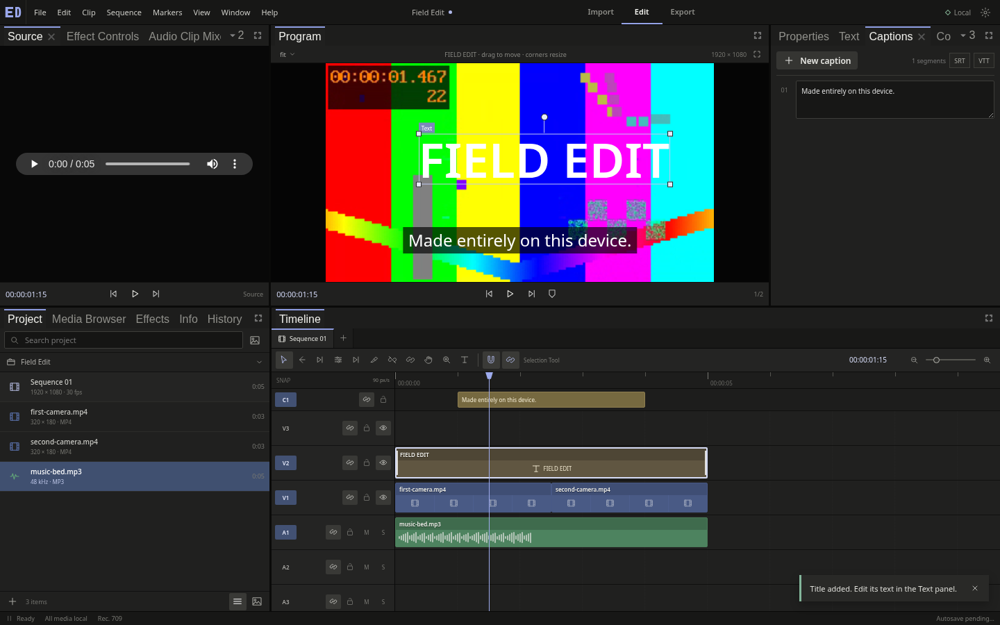
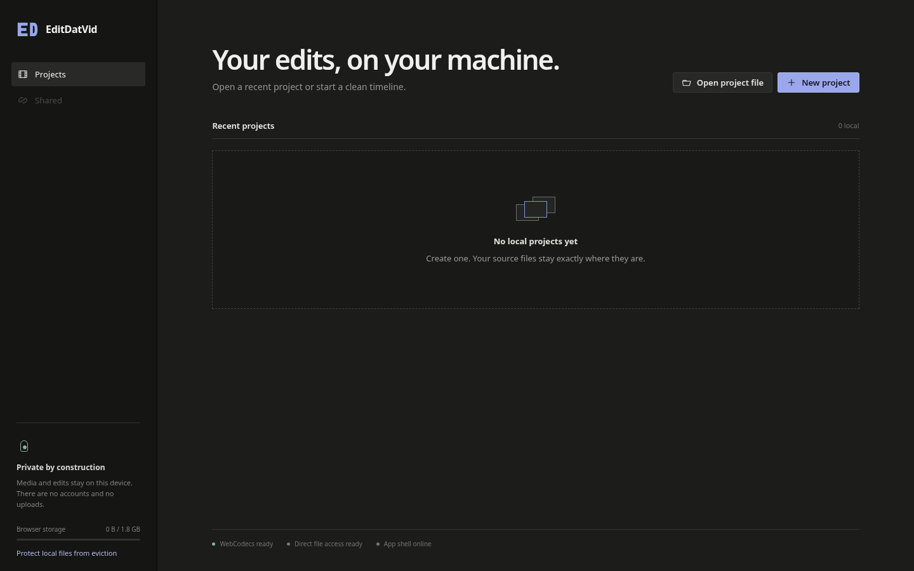
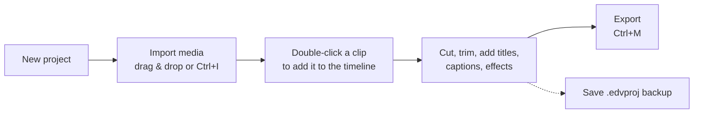
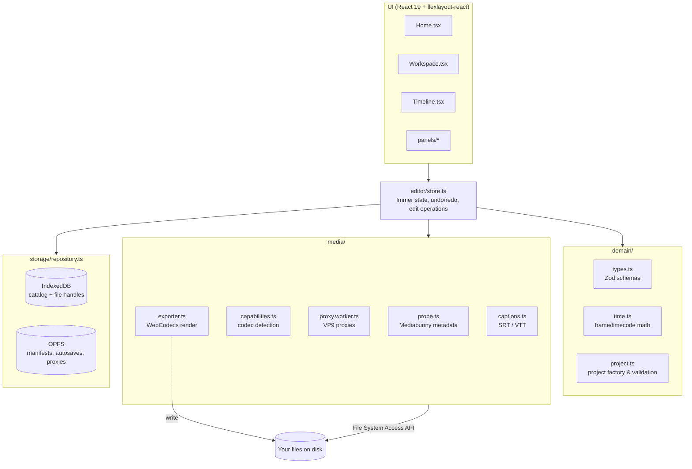
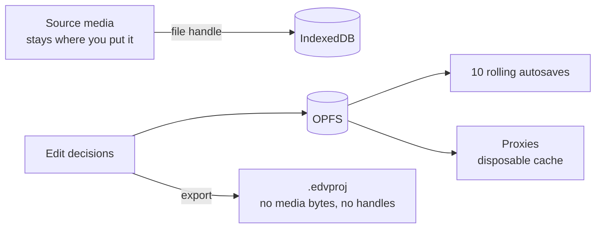

<div align="center">

# EditDatVid

**A private, browser-native video editor. Your media never leaves your machine.**

[](https://github.com/cneuralnetwork/editdatvid/actions/workflows/ci.yml)
[](LICENSE)




</div>

EditDatVid is a Chromium-first, installable (PWA) video-editing workspace. Projects, media analysis, proxies, autosaves and renders all stay on your device. It has no backend, accounts, telemetry or upload path.

> **Status:** v0.1. This is a working foundation for local-first editing. It does not match Premiere Pro or DaVinci Resolve feature for feature. See [Current boundaries](#current-boundaries).

## Contents

- [Features](#features)
- [Quick start](#quick-start)
- [Using the editor](#using-the-editor)
- [Keyboard shortcuts](#keyboard-shortcuts)
- [Architecture](#architecture)
- [Storage contract](#storage-contract)
- [Deploying](#deploying)
- [Development](#development)
- [Current boundaries](#current-boundaries)
- [Contributing](#contributing)
- [License](#license)

## Features

| Area | What you get |
| --- | --- |
| **Projects** | Create, open, rename, duplicate, delete, import/export `.edvproj`, recent projects, storage status and backup guidance |
| **Workspace** | Dockable panels: source/program monitors, project browser, effect controls, captions, color, audio, effects, history, storage, scopes, multiple sequence tabs and persisted layouts |
| **Media** | Local file handles, fingerprint-based relinking, [Mediabunny](https://mediabunny.dev) probing, thumbnails, codec capability detection, and 720p/1080p VP9 proxies generated in a worker and stored in OPFS |
| **Editing** | Multi-track video, audio and captions. Insert, linked move/select, split, trims, delete and ripple delete, markers, snapping, track lock/target/mute/solo/visibility, transitions, speed/reverse/freeze, transform, crop, opacity, color, blur, chroma key, gain and pan |
| **Captions** | Manual editing plus SRT/VTT import and export |
| **Persistence** | IndexedDB catalog, checksummed OPFS project documents, ten rolling autosaves, and cache cleanup |
| **Export** | H.264/AAC MP4, VP9/Opus WebM, WAV, MP3 (where the browser provides it), PNG/JPEG image sequences. Jobs show progress, ETA and can be cancelled |
| **Offline** | Installable manifest and service worker. Imported media is never added to the cache |

<p align="center"></p>

## Quick start

**Requirements**

- [Node.js](https://nodejs.org) 20 or newer (22 LTS recommended)
- A current desktop **Chromium** browser: Chrome, Edge, Brave, Arc or similar. EditDatVid depends on WebCodecs, the File System Access API and OPFS. Firefox and Safari are not supported yet.

```bash
git clone https://github.com/cneuralnetwork/editdatvid.git
cd editdatvid
npm install
npm run dev
```

Open the printed URL (default `http://127.0.0.1:5173`) in Chromium.

## Using the editor



1. **Create a project.** On the home screen, click **New project**, name it and click **Create project**.
2. **Import media.** Drag files onto the Project panel, click the empty drop zone, or switch to **Import** mode (`Ctrl/Cmd+I`). Files are linked where they live on disk and are not copied.
3. **Build the edit.** Double-click an asset to add it to the active sequence. Use the tool bar (or the [shortcuts](#keyboard-shortcuts)) to select, razor, ripple, roll, slip and slide. Right-click a clip for options such as **Detach Audio**.
4. **Polish.** Use **Effect Controls**, **Text**, **Captions**, **Color** and **Audio** panels for the selected clip. Import SRT/VTT captions from the Captions panel.
5. **Export.** Switch to **Export** mode (`Ctrl/Cmd+M`), pick a format your browser can encode, and choose an output location. Formats the browser cannot encode are disabled and the missing encoder is named.
6. **Back up.** Use **File → Export Project File…** to download a portable `.edvproj`. It holds the edit decisions and source fingerprints, not your media. Reopening it on another machine relinks media by fingerprint.

## Keyboard shortcuts

| Keys | Action | Keys | Action |
| --- | --- | --- | --- |
| `Space` | Play / pause | `J` / `K` / `L` | Shuttle reverse / stop / forward (press again to speed up) |
| `I` / `O` | Set sequence in / out | `M` | Add marker |
| `Ctrl+K` | Split at playhead | `Del` / `Shift+Del` | Delete / ripple delete |
| `Ctrl+Z` / `Ctrl+Shift+Z` | Undo / redo | `Ctrl+X` / `C` / `V` | Cut / copy / paste clips |
| `Ctrl+D` | Apply cross dissolve | `Ctrl+Shift+/` | Duplicate selection |
| `S` | Toggle snapping | `+` / `-` | Zoom timeline |
| `` ` `` | Maximize panel | `Ctrl+S` | Save now (flush autosave) |
| `Ctrl+I` / `Ctrl+M` | Import / Export mode | | |

**Tools:** `V` selection · `A` track select · `B` ripple · `N` rolling · `R` rate stretch · `C` razor · `Y` slip · `U` slide · `H` hand · `Z` zoom · `T` type

On macOS, use `Cmd` in place of `Ctrl`.

## Architecture



```
src/
├── domain/      Pure data model: Zod-validated types, time math, project factory (unit tested)
├── editor/      Central store: every edit operation, history, autosave scheduling
├── media/       Probing, capability checks, proxy worker, exporter, caption parsing
├── storage/     IndexedDB + OPFS repository with checksummed documents
└── ui/          React components: home, workspace, timeline and dockable panels
tests/e2e/       Playwright tests that drive a real edit end to end
```

## Storage contract



- Source files stay where you selected them. IndexedDB holds the catalog and structured-cloned file handles.
- OPFS holds current manifests, rolling autosaves, generated proxies and other disposable cache data.
- A portable `.edvproj` contains edit decisions and source fingerprints. It never contains source bytes or browser file handles.

> [!WARNING]
> OPFS is limited by browser quota and is **deleted when you clear site data**. Export `.edvproj` backups of work that matters, and use **Protect local files from eviction** on the home screen to request persistent storage.

## Deploying

EditDatVid builds to a static site in `dist/`, so it can be hosted on any static host (Netlify, Cloudflare Pages, Vercel, nginx, and so on). Two requirements apply:

1. **HTTPS.** Required for the service worker and File System Access API. `localhost` is exempt.
2. **Cross-origin isolation headers** on every response:

   ```
   Cross-Origin-Opener-Policy: same-origin
   Cross-Origin-Embedder-Policy: require-corp
   Cross-Origin-Resource-Policy: same-origin
   ```

```bash
npm run build      # type-check and build to dist/
npm run preview    # serve dist/ locally with the correct headers
```

Example Netlify `_headers` file (place in `public/`):

```
/*
  Cross-Origin-Opener-Policy: same-origin
  Cross-Origin-Embedder-Policy: require-corp
  Cross-Origin-Resource-Policy: same-origin
```

### Docker

```bash
docker compose up --build
```

Serves the production build via nginx on `http://localhost:8080` with the isolation headers preconfigured.

## Development

| Command | Purpose |
| --- | --- |
| `npm run dev` | Start the Vite dev server with COOP/COEP headers |
| `npm test` | Run Vitest unit tests in `src/` |
| `npm run test:watch` | Unit tests in watch mode |
| `npm run test:e2e` | Run Playwright end-to-end tests against a production build |
| `npm run build` | Type-check (`tsc -b`) and build for production |
| `npm run preview` | Serve the production build |

**End-to-end test prerequisites.** Playwright uses the installed Google Chrome (`channel: 'chrome'`). The `field-edit` test generates sample media with `ffmpeg` at `/usr/bin/ffmpeg` and needs the `libopenh264` and `libmp3lame` encoders. Run `npm run build` before `npm run test:e2e`.

```bash
npx playwright install chrome   # if Chrome is not already installed
npm run build && npm run test:e2e
```

## Current boundaries

The preview monitor uses native media elements for low latency. Proxy generation runs in a worker, and export uses Mediabunny/WebCodecs with cooperative main-thread yielding.

Codec availability is checked at runtime. EditDatVid disables unsupported combinations and names the missing encoder. It never silently substitutes a different format.

**Planned after v1** (contributions welcome):

- OffscreenCanvas/WebGL2 preview worker and AudioWorklet mixer
- Effect masks and keyframe curves
- Waveform pyramids, nested sequences, multicam
- Scope-grade analysis, HDR/RAW/ACES, motion tracking
- Third-party plugins and project interchange formats (XML/EDL/AAF)
- Firefox and Safari support as their WebCodecs and file-access APIs mature

## Contributing

Contributions are welcome. See [CONTRIBUTING.md](CONTRIBUTING.md) for setup, conventions and the pull request checklist. Please report bugs and request features through [GitHub Issues](https://github.com/cneuralnetwork/editdatvid/issues).

## License

[MIT](LICENSE)
